# 换肤实战教程：HarmonyOS 应用的四层颜色模型

开源模板：[EasyStart](https://github.com/quizzyjoy/EasyStart)（示例工程 `hm_easystart/`） · 官方文档：[应用内主题换肤](https://developer.huawei.com/consumer/cn/doc/harmonyos-guides/theme-skinning)

正文所有结论都对应 `hm_easystart/` 的现有代码或本目录 `图片/` 下的真机/模拟器截图；代码类结论给出「文件 + 符号」定位，视觉类结论给出截图。

---

## 一、先给颜色归位：四个来源，四套权限

**本节解决**：改完主题后「一部分变了、一部分没变」，先判断没变的那处属于哪一层，再决定改哪里。

### 1.1 一次改色，七处对照

外观页切到青碧（`#12A594`）后逐屏走查，同一次操作会同时出现下面几种结果：

| 观察点 | 结果 | 归属层 |
|---|---|---|
| 首页图标 chip 底、场景强调块、加载动画 | 变 | L3 运行时主题 |
| 组件示例页的主/次按钮、品牌标签 | 变 | L3（原语自读单例） |
| 统一对话框「确认」主按钮 | 变 | L3（`CommonButton` 取色） |
| 未显式着色的系统组件默认色（原生控件、系统弹窗） | 变 | L4 系统组件默认色 |
| HDS 行卡片底色 / 行分割线 / chevron | 不变 | HDS 私有 token（坑 7） |
| HDS `SuffixSwitch` 开关轨道 | 不变 → 显式传色后变 | HDS 私有 token（坑 7） |
| ArkTS 桌面卡片 | 不变 | V1 卡片框架（坑 6） |
| 危险/成功/警告按钮与标签、令牌对照页 | 不变（本就不该变） | L1 语义色与演示 |

基线观感（默认品牌蓝 `#0A59F7`）：

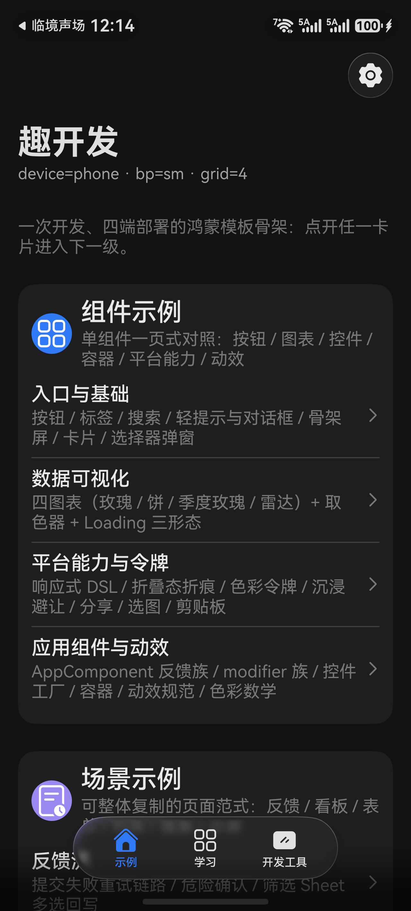

### 1.2 四层的权限边界

| 层 | 机制 | 谁决定颜色 | 单独只改这一层时的表现 |
|---|---|---|---|
| **L1 静态令牌** | `$r('app.color.qj_*')` + `resources/dark` 限定词 | 资源编译器，编译期固化 | 只随深浅色变，不随主题变 |
| **L2 AttributeModifier** | `AttributeModifier` 族（普通类） | 类里 `applyNormalAttribute` 写的值 | 改主题后不重跑，需页面重建 |
| **L3 运行时主题** | `UiThemeManager`（`@ObservedV2` 单例 + `@Trace`） | 运行时单例 | 只有读了它的组件会变 |
| **L4 系统组件默认色** | `ThemeControl.setDefaultTheme(CustomTheme)` | ArkUI token 表 | 不设则系统组件恒为系统蓝 |

一句话：**L1 管编译期，L2 管样式封装，L3 管自绘组件的即时响应，L4 管系统组件的兜底默认。** 四者管的是不同对象，不是同一对象的不同优先级，所以不存在「合成一张大 token 表就全变」的解法——资源值编译期固化、系统组件与 HDS 组件各读自己的 token。

### 1.3 遇到「没跟着变」时的归位顺序

按顺序自问，第一个命中即停：

1. 它是语义色（危险/成功/警告）吗？→ 不该变，结束。
2. 它是系统组件（`Dialog` 主按钮、原生 `Toggle` 轨道、填充 `Button`）吗？→ 查 L4（第五节）。
3. 它是 HDS 组件（`HdsListItemCard` / `SuffixSwitch` 等）吗？→ 查 HDS 显式传色（坑 7）。
4. 它是自绘组件吗？→ 查它有没有读 `UiThemeManager`（第四节）。
5. 它由 `AttributeModifier` 决定吗？→ 查静态中转（第三节）。
6. 以上都不是 → 它是 L1 写死的引用，按第二节规则分级。

### 1.4 深浅色与换肤是正交的两件事

- 深浅色（`ColorModeManager` → 系统 `ColorMode`）决定「底色是白还是黑」；
- 换肤（本教程四层）决定「品牌色是什么」。

两条链路互不驱动：切主题不改显示模式，切显示模式不改主题。这正是 L1 只能承担「随深浅色变」那部分颜色的原因——它随限定词切换：

| 令牌 | `base` | `dark` |
|---|---|---|
| `qj_brand` | `#0A59F7` | `#317AF7` |
| `qj_brand_light` | `#E8F0FE` | `#1D2B45` |
| `qj_on_brand` | `#FFFFFF` | `#FFFFFF` |

（`hm_easystart/AppScope/resources/{base,dark}/element/color.json`）

### 1.5 先量一遍自己的工程

动手改之前先把基线数字拿到手：硬引用有多少、L4 是否已经建立。以下命令在工程根执行（`hm_easystart/`），排除依赖与构建产物：

```
Get-ChildItem . -Recurse -Include *.ets | Where-Object { $_.FullName -notmatch 'oh_modules|\\build\\' } |
  Select-String -Pattern 'qj_brand' -List          # 文件数：还有多少处没进入体系
Get-ChildItem . -Recurse -Include *.ets | Where-Object { $_.FullName -notmatch 'oh_modules|\\build\\' } |
  Select-String -Pattern 'ThemeControl.setDefaultTheme'        # L4 是否已建立
```

同时报告「处数」和「文件数」：处数说明工作量，文件数说明影响面；两者不会相等。

还要单独查一类最隐蔽的引用：`$r('sys.color.*')` 与十六进制字面量。它们不会被 `qj_brand` 命中，但视觉上就是「本该跟主题却始终是系统蓝」的那部分。

### 1.6 验证

1. 记下当前主题色，逐屏截一张图。
2. 外观页切到青碧，再逐屏截同一批图。
3. 按 1.1 的表逐行对照：该变的地方变了、该不变的地方没变，说明四层各就各位；某一格与表不符，按 1.3 的顺序定位。

---

## 二、L1 静态令牌：哪些保留 `$r`，哪些必须迁走

**本节解决**：仓里的 `$r('app.color.qj_brand')` 有一批该迁到运行时主题，有一批必须原样保留——先定规则，再动手。

### 2.1 令牌能做什么、不能做什么

| 能 | 不能 |
|---|---|
| 随 `resources/dark/` 限定词切换深浅色 | 随用户在设置页改的颜色变化 |
| 编译期校验名字，写错立即报错 | 运行期修改它指向的值（无公开 API） |
| 零运行时开销 | 表达「一套主题包」的多色关系 |

所以 L1 的定位是：**承载「不随换肤变、但要随深浅色变」的颜色**，以及「必须精确控制、不接受任何覆盖」的颜色。

### 2.2 三条判定规则

1. **A 类 · 品牌主体 → 迁到运行时**：语义是「品牌强调」、换肤后应当跟着变。典型是图标 chip 底、场景强调块、选中态底、加载动画主色。改法不是把 `$r` 换成 hex，而是把读取源换成 `theme.brandColor()` / `theme.brandSoftColor()`（第四节）。
2. **B 类 · 演示/对照 → 保留 `$r`**：它展示的对象就是令牌本身。典型是 `features/DemoFeature/src/main/ets/view/DesignTokensView.ets` 的令牌对照区——那里必须显示 `qj_brand` 的真实值（`$r('app.color.qj_brand')`），跟着主题变就等于毁掉了这个页面的功能。ArkTS 卡片的 `$r` 也属于这一类（坑 6）。
3. **C 类 · 语义色 → 永不跟主题**：危险 / 成功 / 警告 / 中性。语义色若被主题色覆盖，切到「高对比」（`#0A0A0A`）时用户就看不出哪颗按钮是危险操作。

下面这张图同屏验证了 A、C 两类：主操作/次操作/加载中/品牌标签转成青碧（A 类已迁），危险按钮仍是红、成功标签仍是绿（C 类未动）。

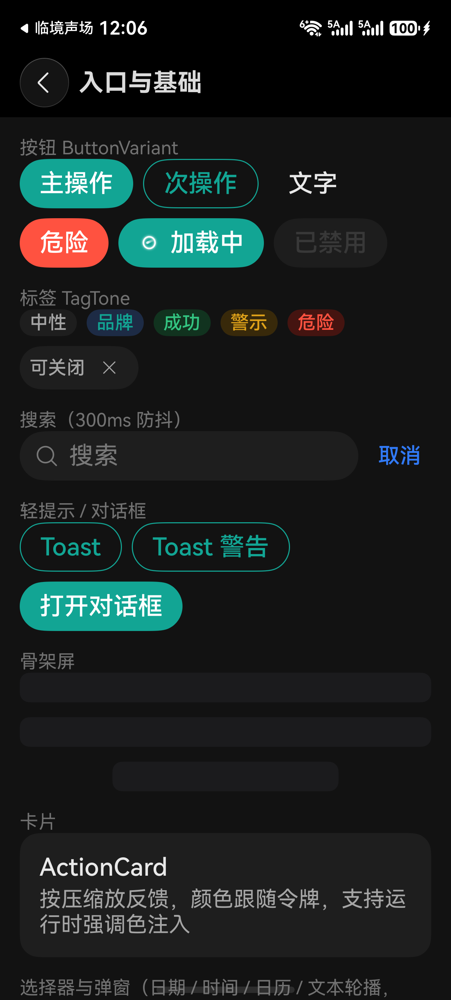

注：同一张图里搜索行右侧的「取消」仍是蓝色，是尚未接入品牌色的位置——这类遗漏只能靠逐屏对照发现，别指望检索 `qj_brand` 能扫出来。

### 2.3 迁移一个 A 类位置的三步

1. **换读取源**：把 `$r('app.color.qj_brand')` 换成 `this.theme.brandColor()`；底色类（chip 底、选中底）换成 `this.theme.brandSoftColor()`。先确认所在组件已持有 `@Local theme = UiThemeManager.getInstance()`，否则后面切主题不会重绘。
2. **补前景色**：压在品牌底上的文字/图标同步换成 `this.theme.onBrandColor()`，否则深色主题（如高对比 `#0A0A0A`）下会出现深底深字。
3. **确认没顺手改语义色**：同一个文件里若有危险/成功/警告色（`app_danger` / `app_success` / `app_warning` 一类令牌），保持 `$r` 原样。改 A 类时最容易连带把它们一起换掉。

### 2.4 默认主题包为什么要回退 `$r`

`UiThemeManager.brandColor()` 的判断不是「有强调色用强调色、否则一律返回 hex」，而是：

```
有强调色            → 返回强调色 hex
无强调色 且 主题包=brand → 返回 $r('app.color.qj_brand')
无强调色 且 主题包≠brand → 返回该主题包的 baseHex
```

中间那一条是刻意的：默认主题包必须保住深浅色。品牌蓝在暗色下需要提亮到 `#317AF7`，这个提亮由 `resources/dark/element/color.json` 的限定词完成；若这里直接返回 `#0A59F7`，暗色下就是「暗底 + 偏暗蓝」。

**由此的已知偏差**：非默认主题包返回的是同一个 hex，不走 `dark` 限定词，所以自绘品牌色在暗色下不会自动提亮；系统组件层不受影响（L4 的 `darkColors` 会提亮，见 5.5）。这是取舍的必然结果，不是缺陷。

### 2.5 验证

1. 在 `hm_easystart` 下检索 `qj_brand`，逐条判 A/B/C（`Get-ChildItem -Recurse -Include *.ets | Select-String 'qj_brand'`）。
2. 切主题包 + 切深浅色各走一遍：A 类应两次都变，B 类两次都不变，C 类两次都不变。
3. 打开令牌对照页，确认它显示的是令牌原值而不是当前主题色。

---

## 三、L2 AttributeModifier：无状态样式的取色通道

**本节解决**：用 `AttributeModifier` 封装的样式，改了主题色却不生效——能不能让 modifier 直接读主题单例？

### 3.1 为什么 modifier 读不到 `@Trace`

`AttributeModifier<T>` 是「样式函数容器」，ArkUI 在需要时调 `applyNormalAttribute(instance)` 把属性写进去。两件事决定了它的边界：

1. 调用时机由框架决定（首次构建、组件重建），**主题单例变化不会触发它**；
2. 它不是 `@ComponentV2`，没有 `@Local`，不在 ArkUI 的观察依赖图里。在它里面写 `UiThemeManager.getInstance().brandColor()` 能编译，但读到的是「那一瞬间的值」，且不会因 `@Trace` 变化被重新调用。

### 3.2 正解：静态中转 + 页面重建刷新

`commons/AppComponent/src/main/ets/theme/AppThemeApplier.ets` 用静态字段做中转：

```
private static currentAccent: string = '';
static brandColor(): ResourceColor {
  return AppThemeApplier.currentAccent.length > 0 ? AppThemeApplier.currentAccent : $r('app.color.qj_brand');
}
```

- **写**：`apply()` 里 `currentAccent = theme.effectiveAccent()`，与 L3/L4 同一次调用完成；
- **读**：所有 modifier 族在 `applyNormalAttribute` 里调 `AppThemeApplier.brandColor()`（`AppButtonModifier` / `AppDividerModifier` / `AppIconButtonModifier` / `AppInputModifier` / `AppProgressModifier`）；
- **刷新**：modifier 实例通常在页面 `build()` 里 `new`，页面重建时会重新执行 `applyNormalAttribute`，此时读到的是最新静态值。

源码注释把这条限制写明：**改色后需要一次页面重建才刷新**，典型触发是「从外观页返回」或系统深浅色切换。

### 3.3 备选：构造参数注入

`AppProgressModifier` 的构造参数默认值取静态中转，调用点可显式覆盖：

```
constructor(color: ResourceColor = AppThemeApplier.brandColor(), ...)
```

好处是某个调用点想特调颜色时不必绕开体系；代价是每个调用点都要决定传不传，漏传就静默走默认值，没有编译期保护。本仓的做法是「静态中转做默认，构造参数留口子」。

### 3.4 两条必须守的纪律

1. **单一写入点**：只允许 `AppThemeApplier.apply()` 写 `currentAccent`，其它任何位置不得赋值，否则会出现「某页用自己的颜色覆盖了全局」的隐蔽 bug。
2. **顺序不能反**：`apply()` 里先 `setPresetId` / `setAccentColor`，**再**取 `effectiveAccent()` 写静态——反了写进去的是上一次的值。

两条都靠「唯一入口 + 注释」维持，没有类型系统保护，因此必须列入回归项（3.6 第 3 条）。

### 3.5 什么时候用 modifier，什么时候别用

| 场景 | 选择 |
|---|---|
| 一组属性复用到多处（描边 + 圆角 + 内边距） | 用 modifier + 静态中转 |
| 需要**即时**响应主题（不重建页面就变） | **别用 modifier**，改成读 `@Local theme` 的自绘组件 |
| 令牌对照 / 演示（要展示固定色） | 用 modifier，但色值写死（B 类） |
| 只有一个属性 | 直接写属性，不必上 modifier |

### 3.6 验证

1. 用 `AppButtonModifier` 渲染一颗按钮，切主题后退出外观页再进入，颜色应为新主题色。
2. 同一屏放一颗 `CommonButton`（L3 路径）与一颗 modifier 按钮，重建后两者颜色应一致。
3. 连续切两个主题（青碧 → 桃粉），每次都在重建后检查，确认没有「停在上一套颜色」的错帧。

---

## 四、L3 `UiThemeManager`：让自绘组件自动重渲染

**本节解决**：怎么让用户改一个设置，全应用的自绘组件在同一帧换色；以及组件侧该怎么读它。

### 4.1 单例形态

`hm_easystart/quizzyjoy/VitalUI/src/main/ets/theme/UiThemeManager.ets`：

```
@ObservedV2
export class UiThemeManager {
  private static instance: UiThemeManager | undefined = undefined;
  @Trace accentColor: string = '';
  @Trace presetId: string = DEFAULT_THEME_PRESET;
  private constructor() {}
  static getInstance(): UiThemeManager { ... }
}
```

选它而不选 `AppStorage` 的理由是模块纪律：VitalUI 必须零 `@kit`（原语库不碰系统设施），而 `@ObservedV2` + `@Trace` 是纯 ArkTS，字段级观测，任何 `@ComponentV2` 里用 `@Local` 持有即建立依赖。

### 4.2 两个字段是叠加关系

| 字段 | 类型 | 语义 |
|---|---|---|
| `accentColor` | `string` | 用户自选强调色 `'#RRGGBB'`；**空串 = 没有覆盖** |
| `presetId` | `string` | 当前主题包 id；空串按默认包处理 |

优先级固定：**强调色 > 主题包**。主题包是基线，强调色是单点微调，两者叠加而非互斥。

### 4.3 四个取色方法

| 方法 | 返回 | 回退链 |
|---|---|---|
| `effectiveAccent()` | `string` hex | 强调色 → 主题包 `baseHex` |
| `brandColor()` | `ResourceColor` | 强调色 → 默认包 `$r('app.color.qj_brand')` → 非默认包 `baseHex` |
| `onBrandColor()` | `ResourceColor` | 默认包且无强调色 → `$r('app.color.qj_on_brand')`；否则按感知亮度选 `#0A0A0A` / `#FFFFFF` |
| `brandSoftColor()` | `ResourceColor` | 默认包且无强调色 → `$r('app.color.qj_brand_light')`；否则 `#26` + 品牌色（15% alpha 叠色） |

`onBrandColor()` 的判定用 sRGB 加权亮度，阈值 `0.62`，亮底配深字、暗底配白字——压在品牌色上的文字/图标一律用它，否则桃粉底白字这类组合会发糊。

### 4.4 `setAccentColor` 的三态语义

```
''                → accentColor = ''（清除覆盖，回退主题包）
'#rrggbb'（7 位）  → 生效（trim + 转小写）
其它               → 忽略，保持原值
```

空串是**语义**而不是「非法输入」。把它当非法输入忽略，就得到「切主题包清不掉上一套强调色」的后果——这就是坑 1 的根因。

配套的三个方法各管一件事，别混用：

| 方法 | 行为 |
|---|---|
| `setAccentColor('')` | 清除强调色，回退到**当前主题包**基准色 |
| `setPresetId('')` | 空串回退默认包 `brand` |
| `reset()` | 双清：`accentColor = ''` + `presetId = DEFAULT_THEME_PRESET` |

### 4.5 组件侧两种读取范式

| 组件类型 | 范式 | 原因 |
|---|---|---|
| **VitalUI 原语** | `CommonButton` / `CommonTag` / `ActionCard` / `CommonLoading`：自持 `@Local theme` **且** 开 `@Param accentColor: string`（空串回退 `brandColor()`）；`CommonColorPicker(Sheet)`：自持 `@Local theme`，当前色由调用侧经 `@Param color` 传 `effectiveAccent()` | 原语要保留「某处特调成别的色」的能力，同时不能因为页面忘传就丢主题 |
| **AppComponent 控件工厂**（`AppToggle` / `AppCheckbox` / `AppSlider` / `AppRadio` / `AppSelect` / `AppSegment` / `AppSearch` / `AppCounter` / `AppGauge` / `AppProgress` / `AppLoadingProgress` / `AppFormField` / `AppTextArea`） | 内部 `@Local theme = UiThemeManager.getInstance()`，不给外部口子 | 原生控件的选中色需逐点覆盖，若让页面传参会大量漏传 |

`CommonButton` 是标准样本：

```
@Local theme: UiThemeManager = UiThemeManager.getInstance();   // 建立观察
@Param accentColor: string = '';                                // 允许页面覆盖
// 取色：accentColor.length > 0 ? accentColor : this.theme.brandColor()
```

这里的空串回退目标是 `brandColor()`（含主题包判断），所以这个三元是**正确**写法。反面写法是「空串直接跳 `$r`」——那会漏掉主题包这一层，见 4.3 第 2 行。

### 4.6 五套主题包，默认品牌蓝

`hm_easystart/quizzyjoy/Foundation/src/main/ets/theme/AppThemePreset.ets`：

| id | 名称 | `baseHex` |
|---|---|---|
| `brand` | 品牌蓝（`DEFAULT_THEME_PRESET`） | `#0A59F7` |
| `violet` | 靛紫 | `#6c4de8` |
| `teal` | 青碧 | `#12A594` |
| `pink` | 桃粉 | `#D6409F` |
| `contrast` | 高对比 | `#0A0A0A` |

一套主题包只声明一个颜色，其余层级（强调底 / 描边 / 选中态）由 L4 按比例派生（第五节）。新增一套主题 = 加一行数据。`resolveThemePreset(id)` 对未知 id 回退到第一套（品牌蓝）。

### 4.7 验证

切到青碧后，外观页自身的预览区三个控件应立即转青碧（它们读 `effectiveAccent()`）：

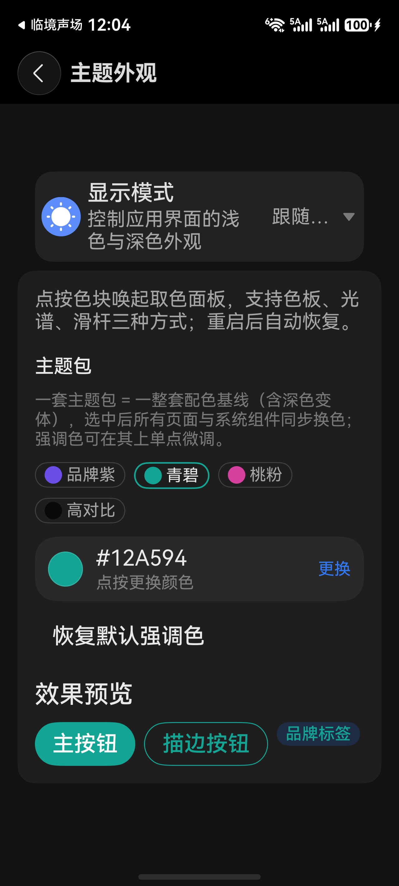

（该图为旧版本界面，只列 4 套主题包；当前源码为 5 套，见 7.1。）

1. 改强调色 → 自绘组件立即变（不重建也算过，因为读的是 `@Trace`）。
2. 切主题包但不设强调色 → 自绘组件也应变（验的是 `brandColor()` 的中间分支）。
3. 打开任意页的 `AppToggle`，切主题后选中轨道应立即变色（验控件工厂范式）。

---

## 五、L4 `ThemeControl`：把「一个色」翻译成一套 token

**本节解决**：你没写颜色的那些系统组件（原生控件的选中态、系统弹窗按钮、输入框光标、动作色）怎么跟着品牌色走，以及这一层为什么盖不住 HDS 与卡片。

### 5.1 为什么必须补这一层

`ThemeControl.setDefaultTheme(CustomTheme)` 写的是 ArkUI 的**应用内默认主题**：凡是没有显式指定颜色的组件，都从这里取色。不设，它们恒为系统蓝；设了，才跟随品牌色。

要分清它和另外两层的分工，否则会误判：

| 位置 | 谁在着色 |
|---|---|
| `CommonButton` 渲染的按钮（含统一对话框的「确认」） | L3——它显式取 `brandColor()` |
| `AppToggle` / `AppSlider` 等控件工厂 | L3——工厂里逐点覆盖了选中色 |
| 未显式着色的原生控件、系统弹窗 | L4——读应用默认主题 |
| HDS 组件 | 都不行，见坑 7 |

本仓绝大多数可见色块都走 L1/L3 的显式路径，所以 L4 的效果不如 L3 抢眼；它的价值是「新加一个没着色的原生控件时不用再补一层代码」。统一对话框的「确认」按钮在主按钮位置上与主题一致——但那条路径是 L3：

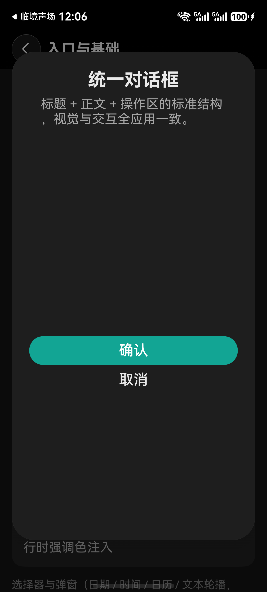

### 5.2 API 形态与版本门槛

`@ohos.arkui.theme`（类型从 `hm_easystart/quizzyjoy/Platform/src/main/ets/theme/AppThemeController.ets` 再导出，保持上层零 `@kit`）：

| 类型 / 方法 | 语义 |
|---|---|
| `CustomTheme` | `{ colors?: CustomColors; darkColors?: CustomDarkColors }` |
| `CustomColors` / `CustomDarkColors` | `Partial<Colors>`，只覆盖需要的 token |
| `ThemeControl.setDefaultTheme(theme)` | 设置应用内默认主题；传 `undefined` 清除 |

版本门槛：`colors` 是 `@since 12`，`darkColors` 是 `@since 20`（本机 SDK `@ohos.arkui.theme.d.ts` 实录）。把 `compatibleSdkVersion` 降到 20 以下，`darkColors` 会编译失败。

### 5.3 只覆盖 7 个 token

51 个 token 全填会引发对比度事故（正文色、背景色被刷成品牌色，层级关系就崩了）。本仓只覆盖「品牌色应当出现」的 7 个：

| token | 作用 |
|---|---|
| `brand` | 填充按钮底、开关选中 |
| `fontEmphasize` | 强调文本 |
| `iconEmphasize` | 强调图标 |
| `backgroundEmphasize` | 强调底 |
| `compEmphasizeSecondary` | 组件强调层（次级） |
| `compEmphasizeTertiary` | 组件强调层（三级） |
| `interactiveSelect` | 选中态 |

判定原则：承担「可读性基线」的 token（正文、背景、分隔线）一律不碰。

### 5.4 浅色：品牌色 + 两档白混

```
brand / fontEmphasize / iconEmphasize / backgroundEmphasize = hex
compEmphasizeSecondary = mix(hex, '#FFFFFF', 0.82)
compEmphasizeTertiary  = mix(hex, '#FFFFFF', 0.90)
interactiveSelect      = 同 tertiary
```

`mix()` 是标准线性插值：两个 hex 拆成 RGB，按比例加权取整后拼回 `#RRGGBB`。这十几行是「一个色生成一套色」的关键，也是主题包只声明一个色的兑现方式。

### 5.5 深色：先提亮，再往黑混

```
lifted = mix(hex, '#FFFFFF', 0.28)          // 暗底上原色会发闷，先抬亮一档
soft   = mix(lifted, '#000000', 0.72)
soft2  = mix(lifted, '#000000', 0.82)
```

柔和层在深色下必须「向背景靠拢」，而背景是暗的——所以往黑混。方向做反了，深色下所有 chip 会发光。

### 5.6 三个工程细节

1. **归一化 + 拒绝非法值**：`normalize()` 接受 `#RRGGBB`，也接受 9 位 `#AARRGGBB`（去掉 alpha）；非法输入返回空串，`applyPreset` 记一条 warn 后跳过，绝不把非法值塞给系统组件。
2. **重复调用短路**：静态 `applied` 记录上次生效值，值没变直接返回 `true`，省掉「打开外观页又点同色」的无效全局重算。
3. **失败不阻塞启动**：整段包在 `try/catch`，失败只记 warn 并返回 `false`。L4 是兜底层，它失败时 L1/L3 仍工作——绝不该因为主题失败白屏。

### 5.7 能力边界（三条）

| 边界 | 表现 | 去哪看 |
|---|---|---|
| 显式 set 过的属性不被覆盖 | 你写了 `.backgroundColor(...)`，主题改不动它 | 第二节分级 |
| **HDS 私有 token 不吃这套** | `HdsListItemCard` 底色 / 分割线 / chevron 不变 | 坑 7 |
| **V1 卡片框架不参与** | ArkTS 卡片保持令牌色 | 坑 6 |

### 5.8 验证

1. **看默认色是否被接管**：在任意页临时放一个不设颜色的原生 `Toggle()`，切主题后它的选中轨道应随主题变；撤掉 `AppThemeController.applyPreset` 的调用后应变回系统蓝。这是 L4 唯一的直接取证方式——别拿自绘按钮当证据。
2. **看 darkColors**：浅 → 深 → 浅往返切换，L4 覆盖的强调底应随限定走暗色分支；若深色下出现「亮底亮字」，直接看坑 5。
3. **看短路与容错**：主题色不变时再点一次同一主题包，`hilog` 中不应出现新的 `theme applied`；把 `ACCENT_COLOR` 手动写坏后重启，应看到 `applyPreset skipped: invalid hex`，且界面仍可用。

---

## 六、编排与冷启动：一次调用铺满两层

**本节解决**：四层建好后谁按什么顺序调用；冷启动怎么做到「打开就是上次的颜色」。

### 6.1 编排类为什么只能放 `AppComponent`

两条依赖约束把位置锁死了：

```
VitalUI   不能依赖 Platform（原语库要零 @kit）
AppCommon 不能依赖 VitalUI（手表要能用）
```

而「铺层」这件事需要同时操作 L3（`UiThemeManager`，在 VitalUI）与 L4（`AppThemeController`，在 Platform）。只有 `AppComponent` 同时依赖两者——`commons/AppComponent/src/main/ets/theme/AppThemeApplier.ets` 就是唯一合法位置。

### 6.2 `apply()` 的四步顺序

```
theme.setPresetId(presetId);                 // 空串 → 默认包
theme.setAccentColor(accentHex);             // 空串 → 清除覆盖
currentAccent = theme.effectiveAccent();     // 静态中转（第三节）
AppThemeController.applyPreset(theme.presetId, theme.accentColor);  // L4
```

三条纪律：**先写单例再取 `effectiveAccent()`**（反了会写入上一次的值）；**L3 在前 L4 在后**（自绘组件同一帧就能取到新色）；**两者互不依赖**（L4 失败不影响 L3）。返回值的语义是「L4 是否成功」——返回 `false` 不代表什么都没做，调用方不该据此回滚。

### 6.3 三个入口方法

| 方法 | 何时用 | 行为 |
|---|---|---|
| `apply(presetId, accentHex)` | 冷启动恢复、外观页幂等再落地 | L3 + L4 + 静态中转 |
| `applyAccent(accentHex)` | 取色器确认 | 保留当前 `presetId`，只换强调色 |
| `applyPreset(presetId)` | 切换主题包 | 保留当前 `accentColor`，只换主题包 |

`applyPreset` **不替你清强调色**——清不清是页面职责（7.2），落地器只做「按给定参数铺层」，不猜用户意图。

### 6.4 `restoreTheme()`：只读，不注入

`hm_easystart/commons/AppCommon/src/main/ets/bootstrap/AppBootstrap.ets` 的 `restoreTheme()` 返回纯数据 `AppThemeState { presetId, accentHex }`，不碰任何表现层 API。读取顺序：

| 键 | 说明 |
|---|---|
| `accent_color` | 现行强调色键 |
| `accent_preset` | 历史枚举键，仅在现行键为空时回退；其值本身是 hex 直通，`'default'` 这类非 hex 视为无记录 |
| `theme_preset` | 主题包 id（空串 = 默认品牌蓝） |

强调色要过 `ACCENT_HEX_PATTERN` 校验：合法才返回小写 `'#rrggbb'`，否则返回空串。持久化数据可能来自旧版本或被写坏，在校验处拦掉，日志里还能留一条明确的 warn。

### 6.5 冷启动时序：为什么要接受「异步恢复」

```
onCreate
 ├─ AppBootstrap.prepare(this.context)
 ├─ AppBootstrap.restoreTheme().then(state => AppThemeApplier.apply(...))   // 异步
 └─ captureCardTarget(want)
onWindowStageCreate
 └─ windowStage.loadContent('pages/Index', cb)                              // 首帧渲染
```

`restoreTheme()` 内部 `await` 持久化读取，`loadContent` 在 `onWindowStageCreate` 调用——两者的先后取决于读取完成的时刻，代码不保证 `apply()` 一定早于首帧。若 `apply()` 落在首帧之后，第一帧渲染的是默认包（`presetId` 初值 `brand`）的颜色，随后再重渲染成上次的颜色。

排查与缓解：

1. 用 `hilog` 时间戳对比 `theme restored: preset=…` 与首帧渲染日志的先后，先确认本机是否真的发生。
2. 若确有先后问题，在 `loadContent` 回调里再调一次 `AppThemeApplier.apply(...)`——幂等、几乎零成本（`AppThemeController` 的 `applied` 短路会挡掉重复设置）。
3. 更彻底的做法是把主题值在 `prepare()` 阶段同步读进内存，代价是持久化层改造；本仓未采用。

### 6.6 各端接入

每个入口 Ability 自己写这一句，`AppCommon` 保持对 VitalUI 零依赖：

```
AppBootstrap.restoreTheme().then((state: AppThemeState): void => {
  AppThemeApplier.apply(state.presetId, state.accentHex);
});
```

| 入口 | 是否恢复主题 |
|---|---|
| `entry`（手机/平板/折叠） | 是，`EntryAbility.onCreate` |
| `entry_pc`（2in1） | 是，`PcAbility` |
| `entry_tv` | 是，`EntryTvAbility` |
| `entry_wearable`（手表） | 否，保持默认主题（源码注释即此决策） |

2in1 宽屏下同一套编排同样生效：


### 6.7 进外观页幂等再落地

`AccentColorSetting.aboutToAppear()` 的顺序是：读强调色（含历史键回退）→ 读主题包 → `setAccentColor` / `setPresetId` → **再调一次 `AppThemeApplier.apply()`**。

最后一句是防御式的：万一某个入口漏调，用户进一次外观页四层就被补齐。把「关键状态落地」做成幂等 + 多触发点，比追求「只在启动时调一次」更抗遗漏。

### 6.8 验证

1. 设成青碧 → 杀进程 → 冷启动：首屏即为青碧（读 `hilog` 的 `theme restored: preset=teal`）。
2. 手机 / 2in1 / TV 各走一遍同样流程，确认三端都能恢复。
3. 手表端启动后主题保持默认（`entry_wearable` 无 `restoreTheme` 调用，属预期）。

---

## 七、外观页：主题包 chips + 取色器

**本节解决**：给用户一个能选出「整套主题」和「单点强调色」的界面，并保证切包时旧强调色被清掉、落库也被清掉。

### 7.1 页面结构

在 `hm_easystart/commons/AppSettings/src/main/ets/component/AccentColorSetting.ets` 里按顺序落四块：

1. **说明文案**：`settings_accent_desc`。
2. **主题包 chips**：`Flex({ wrap: FlexWrap.Wrap })` + `ForEach(appThemePresets())`，每颗 chip = 16vp 圆点（`preset.baseHex` 直接当底色，这是唯一允许直接把 `baseHex` 当背景色的地方——它就是色卡本身）+ 名称；选中态用 `border 1.5 + preset.baseHex`，未选中用 `1 + app_divider`。
3. **取色器**：`CommonColorPickerSheet({ color: this.theme.effectiveAccent(), ... })`。
4. **恢复默认 + 预览区**：`CommonButton(TEXT)` 一行，下面 `CommonButton(PRIMARY)` / `CommonButton(SECONDARY)` / `CommonTag(BRAND)` 三个预览，均显式传 `accentColor: this.theme.effectiveAccent()`。

五套主题包齐备、选中青碧时的外观页：

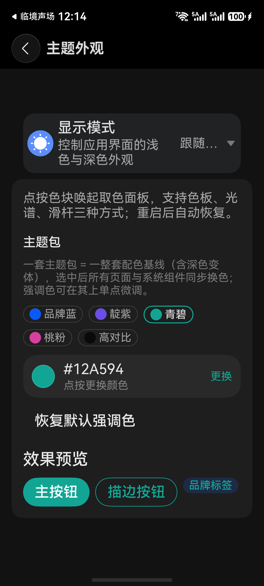

### 7.2 切包：清强调色 + 落库清空

`applyPreset(presetId)` 的四步，最后一步最容易漏：

1. `theme.setAccentColor('')` —— 清掉内存里的强调色覆盖；
2. `theme.setPresetId(presetId)`；
3. `AppThemeApplier.applyPreset(presetId)`；
4. `PreferencesStore.put(THEME_PRESET, presetId)` **且 `put(ACCENT_COLOR, '')`**。

第 4 步漏了会得到一个只在重启后复现的 bug：当前会话看着对，杀进程重进——`restoreTheme()` 读到旧强调色，又把主题包盖住了。

### 7.3 取色器：draft 确认制

`CommonColorPickerSheet`（`quizzyjoy/VitalUI/src/main/ets/component/CommonColorPickerSheet.ets`）的交互契约是「拖动只写内部分 `draft`，确认才回调 `onColorChange`，取消丢弃」。调用侧只做一件事：

```
applyColor(color): setAccentColor(color) → apply(presetId, accentColor) → put(ACCENT_COLOR, color)
```

### 7.4 「恢复默认」是回主题包，不是回默认主题包

`applyColor('')` 走的是「清强调色」，因此界面回到**当前主题包**的基准色。这个语义必须与按钮文案一致：文案若是「恢复默认强调色」，行为就是清覆盖，而不是把 `presetId` 也重置为 `brand`。

### 7.5 收藏色的读写

取色器里还有一份收藏色列表，存储方式是单键 + 逗号拼接（`PreferenceKeys.FAVORITE_COLORS` = `favorite_colors`，上限 `FAVORITE_MAX` = 6）：

1. **读**：`split(',')` → 逐项 trim + 转小写 → 只保留 7 位 `#` 开头 → 去重 → 截断到 `FAVORITE_MAX`。
2. **写**：`saveFavorites()` 同样先截断再 `put(...join(','))`，同时回写本地 `@Local favorites`。

逐项校验不能省：这个键是用户可手动改的文本，一条脏数据会让取色器渲染出非法色块。

### 7.6 验证

1. 选青碧 → 预览区三个控件立即转青碧；取色块显示 `#12A594`（它显示的是 `effectiveAccent()`，不是「用户是否设过强调色」）。
2. 先设一个强调色，再点另一套主题包 → 强调色被清、界面整体换成新主题包；杀进程重进，仍是新主题包。
3. 点「恢复默认」→ 回到当前主题包的基准色；再杀进程重进，基准色保持。
4. 拖动取色器后点取消 → 界面颜色不变（验 draft 语义）。
5. 收藏两个颜色 → 杀掉进程重进 → 收藏仍在，顺序不变。

---

## 八、七个主题链路的坑（现象 → 原因 → 改法）

### 坑 1：切主题包「没反应」

**现象**：外观页点青碧，chip 的选中描边变了，但预览区、首页、组件页几乎没变，像「只换了个选中框」。

**原因**：`effectiveAccent()` 的优先级是「强调色 > 主题包」。切包时若不处理强调色，改的就是优先级更低的那个变量；若 `setAccentColor` 又把空串当非法输入忽略（只接受合法 hex），「清除强调色」在 API 层就根本做不到。

**改法**：把空串定义成第三种语义（4.4），并在页面切包时显式清内存 + 清落库（7.2）。这条是「语义缺陷伪装成 UI 缺陷」的典型：现象在界面，根因在单例的一个 `if` 分支。

下面这张图是理解该坑的关键：主题包选中「品牌紫」时，取色块显示 `#6c4de8`——这正是该主题包的 `baseHex`，即「当前生效色」，而不是用户设过的强调色。取色块显示生效色，说明「切包看起来没反应」只能从优先级与清除逻辑上找原因：

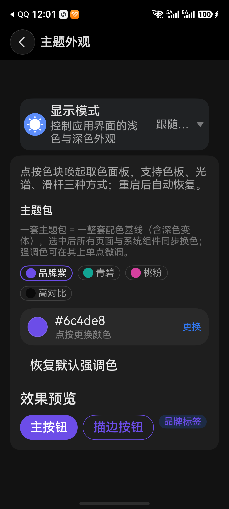

（该图为旧版本界面：只有 4 套主题包、紫色包名为「品牌紫」；当前源码是 5 套、紫色包名为「靛紫」、id 为 `violet`。）

### 坑 2：只改单例，VitalUI 原语按钮仍然蓝

**现象**：`UiThemeManager` 建好、`AppComponent` 的控件工厂全部跟随，但 `CommonButton` 渲染的「主操作」、`CommonTag` 的「品牌标签」仍是默认品牌蓝。

**原因**：原语若只读 `$r('app.color.qj_brand')`，它就不认识单例；此时「跟随主题」只能靠页面传 `@Param accentColor`，而绝大多数页面不会传——「注入面覆盖了」和「界面显示品牌色」是两件事。

**改法**：原语自己持有单例，同时保留外部覆盖口子（4.5 的 `CommonButton` 样本）。两者都要：只靠 `@Param` 必然大量漏传，只靠单例则失去「某处特调」的能力。回退目标必须是 `brandColor()`，不能是 `$r`。

判定信号：**「重建页面就对了」= 求值时机问题（坑 3）；「重建也不对」= 根本没连上（本坑）。**

### 坑 3：`@Param` 默认值读单例，改色不响应

**现象**：组件首帧颜色正确，之后任何页面改主题都不动；切走再回来（组件重建）又对了。错误写法只有一行：

```
@Param accentColor: string = UiThemeManager.getInstance().effectiveAccent();
```

**原因**：`@Param` 默认值是表达式，只在**创建组件实例时求值一次**。值被固化（后续变化不回写），且这次读取不在渲染期，依赖未被记入观察图。

**改法**：`@Local` 持有对象本身，把读取放进 `build` 调用链：

```
@Local theme: UiThemeManager = UiThemeManager.getInstance();
// 取色：this.theme.brandColor()
```

`@Param accentColor: string = ''` 是安全的（默认值是常量），只有「默认值里读单例」才是坑。

### 坑 4：顶层 `@Builder` 不能用 `this`，也读不到单例

**现象**：全局悬浮球（`commons/AppComponent/src/main/ets/feedback/AppOverlay.ets`）的品牌圆钮，无论怎么换主题，底色恒为默认品牌蓝。

**原因**：`@Builder` 定义在文件顶层（不是 `struct` 成员）时没有 `this`，不属于任何组件的渲染作用域，通常还经 `ComponentContent` 从组件外部注入——「在 builder 里读主题色」缺的不是写法，是上下文。

**改法**：内容对象注入，把「读色」搬到有上下文的一侧。

```
class AppFloatingBallContent { tint: ResourceColor = $r('app.color.qj_brand'); onTint: ResourceColor = $r('app.color.qj_on_brand'); }
// builder 内只用 content.tint / content.onTint
// show() 侧：content.tint = theme.brandColor(); content.onTint = theme.onBrandColor();
```

注意：`ComponentContent` 构建后，内容对象字段的后续变化不会重绘 builder——正确预期是「下一次 `show()` 生效」。`product/entry/src/main/ets/pages/Index.ets` 的 `splitPlaceholderBuilder` 是反向样本：它只用 `$r`、不用 `this`，主动规避了这条约束。

### 坑 5：只给 `colors` 不给 `darkColors`，暗色下亮底亮字

**现象**：浅色一切正常；切深色后强调底仍是「浅色逻辑算出来的偏亮值」，压在上面的前景按暗色渲染，对比度崩坏。

**原因**：`darkColors` 不提供时，暗色模式**沿用 `colors` 的值**，不会自动变暗。官方 d.ts 对此有明文：不设 `darkColors` 时颜色值与浅色一致、且不随色彩模式变化，除非该色由 `dark` 目录的资源指定。而浅色的柔和层是「往白混」（82% / 90% 白），在暗色界面里等于主动提亮。

**改法**：两层都做——内容层深色单独算一套（5.5，往黑混）；结构层只暴露一个返回完整对象的方法，让「只给一半」不可能发生：

```
static buildTheme(hex: string): CustomTheme {
  return { colors: AppThemeController.lightColors(hex), darkColors: AppThemeController.darkColors(hex) };
}
```

用结构固化约束，比在文档里写「请务必成对」有效得多。

### 坑 6：ArkTS 卡片只能 V1，接不上 V2 单例

**现象**：想让桌面卡片的品牌色跟随应用内主题，照 4.1 加 `@Local theme = UiThemeManager.getInstance()`，不生效。

**原因**：卡片入口是 `@Entry(cardStorage) @Component` + `@LocalStorageProp`，框架当前只支持 V1（源码注释即此说明）；而 `@ObservedV2` + `@Trace` 只在 `@ComponentV2` 里通过 `@Local` 观测。两条叠加：卡片在架构上不可能跟随运行时主题，不是配置问题也不是写法问题。

**改法**：卡片颜色继续用 `$r('app.color.*')` 令牌——深浅色仍正确，只有「跟随用户换肤」这一项拿不到。这是取舍而非遗留缺陷：强行做需要「应用写偏好 → 卡片读偏好 → 重绘」的自建链路，且要处理「应用未运行时卡片首次加载」的缺省值。

同页还有一条卡片专属的坑：卡片的 `@LocalStorageProp` 值若经**带值参数的 `@Builder`**（如 `rowValue(this.themeText)`）转手，会被按值捕获、永不重渲染（源码注释记录了 v3.27 真机现象：标题/时间等直读字段正常，显示/语言/字号恒为默认值）。修法是为每个状态行写无参数 `@Builder`、内部直读状态——与坑 3 是同一机制。

| 入口 | 状态管理 | 能否接 L3 单例 |
|---|---|---|
| 应用内页面（`@Entry @ComponentV2`） | V2 | 能 |
| 应用内遗留 V1 组件（`@Component`） | V1 | 不能，需先迁 V2 |
| ArkTS 卡片（`@Entry(cardStorage) @Component`） | V1（框架限制） | 不能，不可迁 |

### 坑 7：HDS 私有 token 不吃 `ThemeControl`

**现象**：切换青碧后走查设置页，同一页里自绘元素已转青碧，但下面这些位置（修复前）不变：

| 位置 | 修复前的表现 |
|---|---|
| 「触感反馈」「屏幕常亮」开关 ON 轨道 | 系统蓝，不随主题 |
| HDS 行卡片底色 | 中性灰 |
| 行分割线 | 中性灰 |
| 行尾 chevron 箭头 | 中性灰 |

切青碧后的设置页（深色模式）：HDS 行卡片底色与 chevron 仍是中性灰，不随主题：

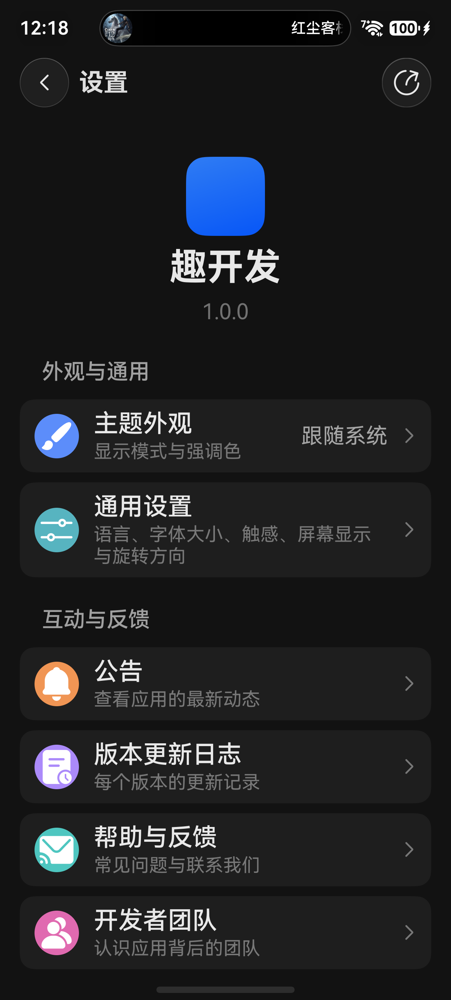

**原因**：页面上看到的开关不是自绘的 `SettingsSwitchRow`，而是 HDS 的 `SuffixSwitch`——设置域是 schema 驱动的（`SchemaSettingsSection` 按 `rawfile/settings_schema.json` 渲染），`builtin: 'haptic'` / `'keepScreenOn'` 两行走的是 `HdsListItemCard({ suffixItem: new SuffixSwitch({ isCheck, onChange }) })`，没有任何颜色参数。HDS 组件画在 ArkUI 之上但读自己的私有 token，不在这张 51 项的表里，所以 `ThemeControl` 对它无效。排查前先确认这个像素是谁画的。

**改法**：HDS 只认显式传色，去 d.ts 找口子而不是猜属性名。本机 SDK `@hms.hds.hdsBaseComponent.d.ets` 里 `CheckOptions.selectColor?: ResourceColor`（`@since 6.0.0(20)`）就是入口，两处实例各补一行：

```
new SuffixSwitch({
  isCheck: this.vm.hapticEnabled,
  selectColor: this.theme.brandColor(),   // 新增
  onChange: …
})
```

同时给 `SchemaSettingsSection` 补观测上下文 `@Local theme: UiThemeManager = UiThemeManager.getInstance();`——只传 `selectColor` 而不持有 `@Local theme`，首帧正确但切主题不重绘（坑 3 的同一机制）。

修好后「触感反馈」ON 轨道为青碧，「屏幕常亮」为 OFF 灰态：

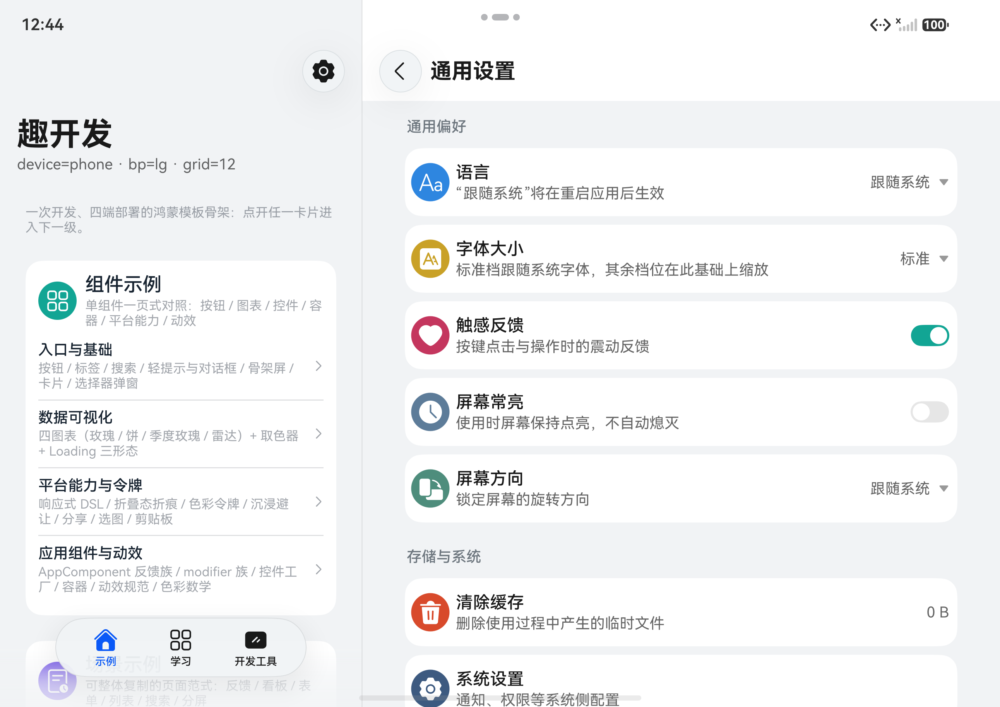

| HDS 元素 | 能否跟随 | 路径 |
|---|---|---|
| `SuffixSwitch`（本仓两处） | 能，已跟随 | `CheckOptions.selectColor` |
| `HdsListItemCard` 底色 / 分割线 / chevron | 不能，仍不跟随 | 需 `HdsListItemCardModifier` 或显式 tint（本仓未做） |

HDS 的跟随是「逐组件、逐 token」的工程：谁提供了 `ResourceColor` 口子就接谁，没口子的不要给组件套 `.backgroundColor()`（会被其内部 token 覆盖）。验证一律取像素，而不是「看起来变了」。

---

## 九、两个布局坑：它们会让主题问题看起来更严重

**本节解决**：宽屏分栏后出现的「卡片被压扁」「页签跑到上面」——这两处与换肤无关，但与主题问题在真机走查里同时出现，会成倍放大「主题没生效」的错觉。

### 坑 8：列数要按容器宽算，不能按窗口断点算

**现象**：阔折叠展开、分栏左栏里「开发工具」网格被压成 4 列，卡片窄、标题与描述大量截断。

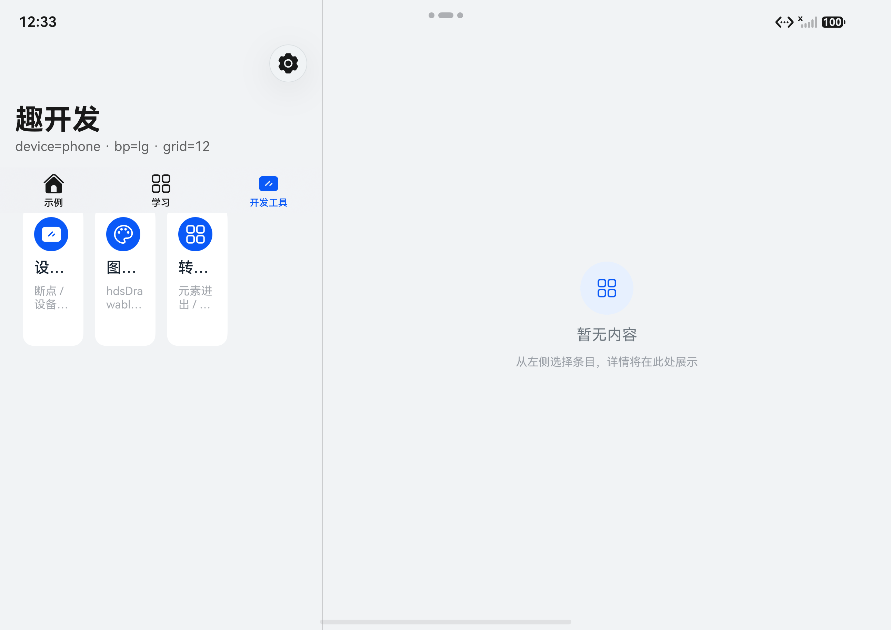

**原因**：入口页在宽屏下进入 `NavigationMode.Split`，左栏只占窗口宽度的一部分，`Navigation` 默认左栏在 Pura X Max 这类设备上只有约 320vp（`Index.ets` 注释记录的实测值）。断点仍是 `lg`（窗口足够宽），但页面实际容器只有 320–420vp——列数按「大屏」给、容器按「小屏」算，每列被压扁。

**改法**：三步一起做。

1. 把左栏宽度显式定下来（`Index.ets` 的 `navBarWidthValue()` / `navPaneWidthVp()`）：`lg`/`xl` 取 `clamp(340, 窗口宽 × 0.32, 420)`，`md` 取 `44%`，`sm` 不分栏返回 `100%`；再用 `navBarWidthRange({ minWidth: 300, maxWidth: 440 })` 兜边界。比例保证随窗口缩放，clamp 保证两端不发散。
2. 把**数值容器宽**下传：未分栏时 `navPaneWidthVp()` 返回 0，分栏时返回同一套算式的结果，作为 `@Param paneWidthVp` 传给子视图。
3. 子视图按容器宽分档（`features/DemoFeature/src/main/ets/view/ToolsView.ets` 的 `columns()`）：`< 480 → 2`、`< 760 → 3`、`≥ 760 → 4`；宽为 0 时退回断点判断（`sm → 2`、`md → 3`、其它 `→ 4`）。420vp 的容器落在 `< 480` 这一档，于是得到 2 列：

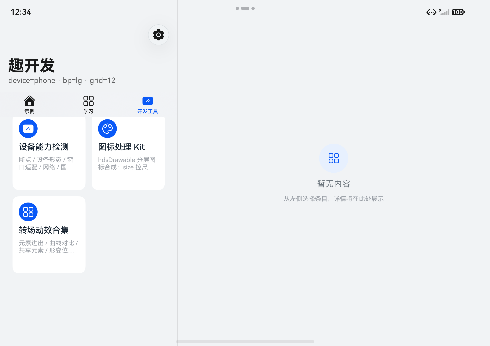

两次的窗口断点完全相同，变的只是「按什么宽度算列数」。

配套还有一条：`Grid` 放进 `Scroll` 内不会自动撑高，会塌成 0，需要显式算高，而高度计算依赖列数——两者是同一个决策的两个输出，必须写在同一个视图里：

```
rows = ceil(条目数 / columns());
height = rows * CARD_HEIGHT + (rows - 1) * CARD_GAP;
```

**判断规则**：断点回答「设备是什么形态、要不要分栏」，容器宽回答「我这一块有多少地方画、能放几列」。

### 坑 9：`HdsTabs.barPosition` 必须恒定，不能按断点切

**现象**：宽屏分栏下底部页签「跑了」——`示例 / 学习 / 开发工具` 出现在左栏**顶部**，横在页面标题与内容卡片之间，看起来像一组次级导航。

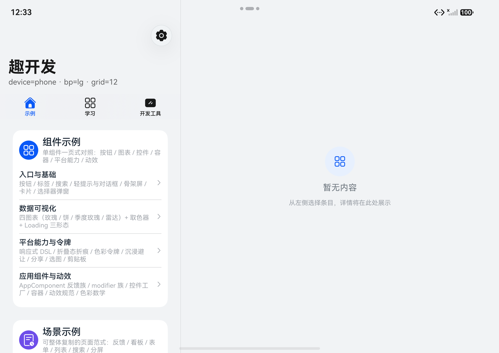

**原因**：原写法是 `.barPosition(this.breakpoint.isWide() ? BarPosition.Start : BarPosition.End)`，意图是「宽屏时页签放到上面，更符合平板习惯」。但分栏语境下 `HdsTabs` 的容器已经不是整屏而是左栏，`Start` 把页签放到左栏顶部——正好插在标题与列表之间，既不像顶部导航，也不再是底部页签。

**改法**：恒为底部，与 2in1 端一致。

```
.barPosition(BarPosition.End)   // 恒定，不随断点变化
```

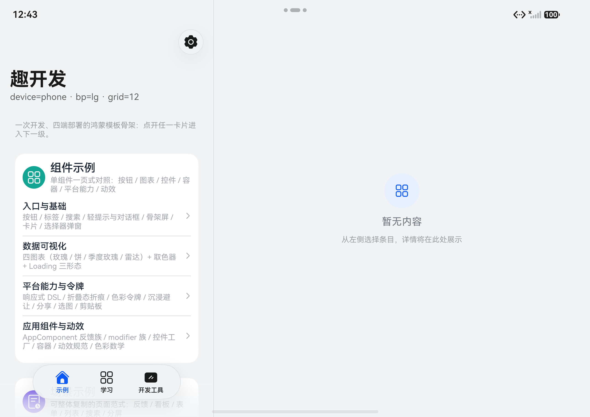

想做 rail 导航得单独设计：图标+文字重排、宽度预算、选中指示器方向、内容区让位，改一个 `barPosition` 得不到 rail。另外页签用了 `barOverlap(true)` + `barFloatingStyle`，会覆盖在列表之上——这是沉浸式的既有设计，不是遮挡 bug，前提是列表底部留了 padding。

2in1 端页签天生在底部、分栏是常态，可作对照：

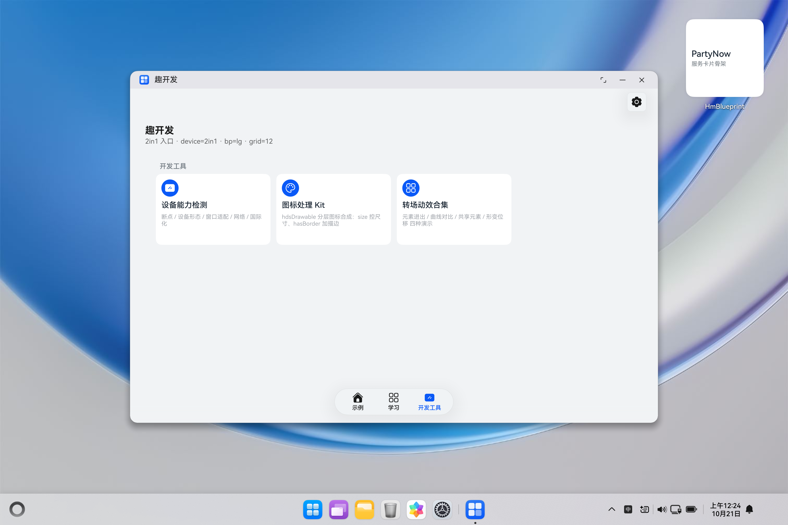

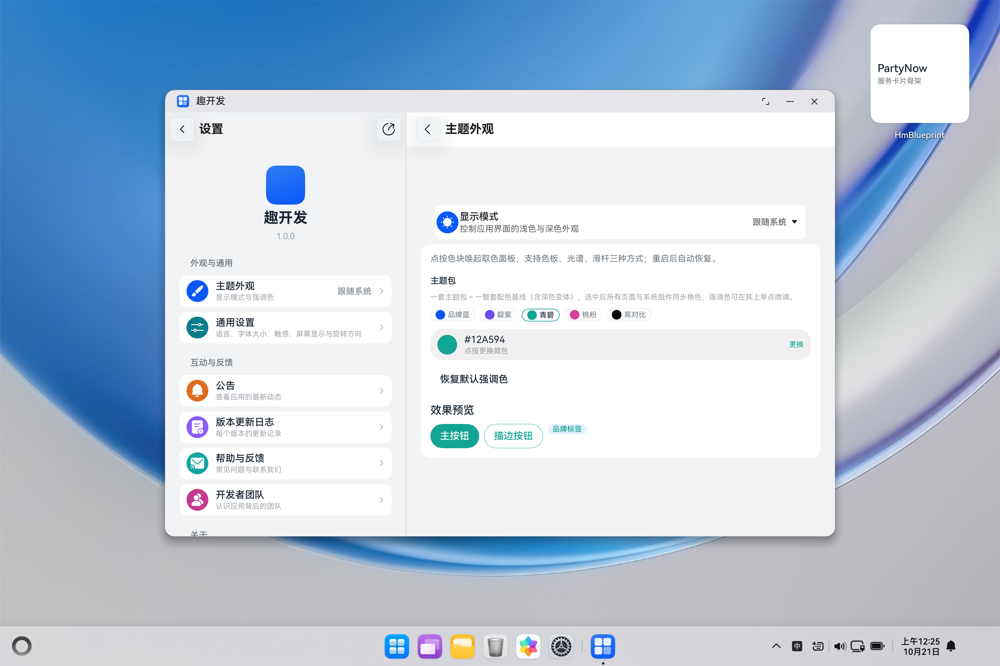

### 取证纪律：两组截图不能混用

- `E4` 修的是**网格列数**（此时页签仍在顶部）；`G0` / `G2` 才是**页签位置修复后**的状态。把二者当成同一次修复的证据，会得出「改了 A 同时修好了 B」的错误因果。
- 走查按形态分组：手机竖屏 / 阔折叠展开（分栏）/ 2in1 宽屏，每组的容器宽差异巨大，同一套断点逻辑在其中几组上必然出错。
- **先修布局再看颜色**：分栏后文字被截断会被误读成「主题把字变没了」，两者混在一起极难定位。

### 验证

1. 阔折叠展开进入分栏，工具网格应为 2 列、标题与描述不被截断，左栏宽度落在 340–420vp。
2. 页签位于左栏底部浮动胶囊，不在标题与列表之间。
3. 滚动到列表末尾，最后一行完整可见（验底部 padding 已预留）。
4. 切到青碧，页面上不应再残留默认品牌蓝的强调块（搜索行「取消」这类系统默认色位置除外）。阔折叠分栏下的整体效果：

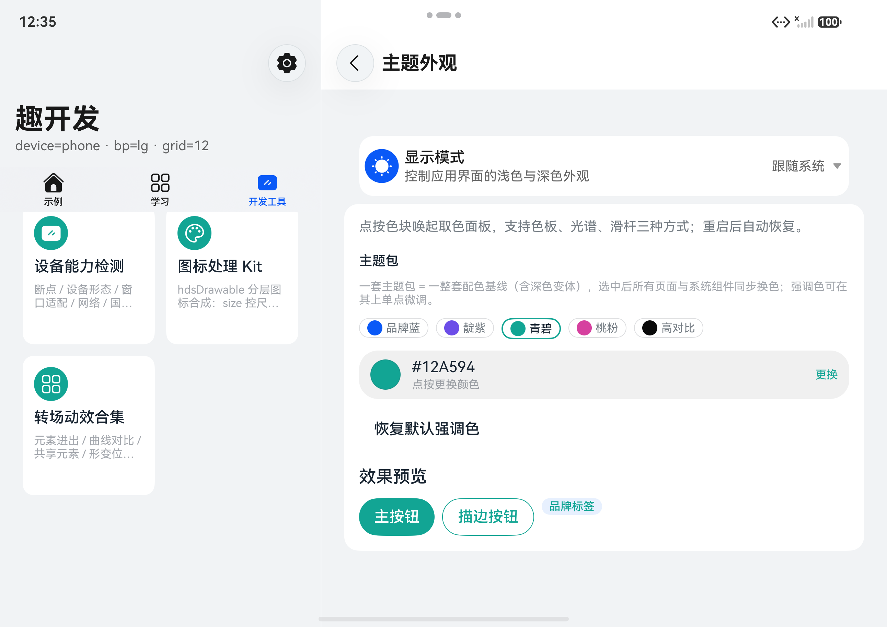
